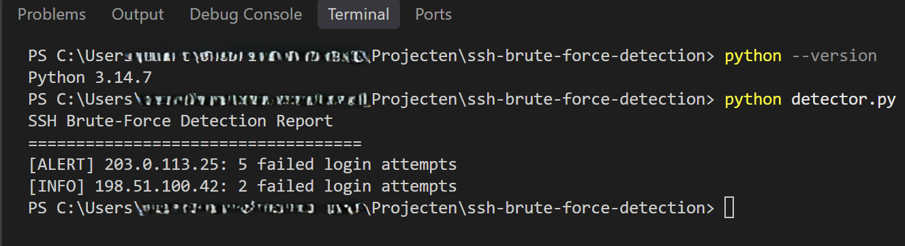
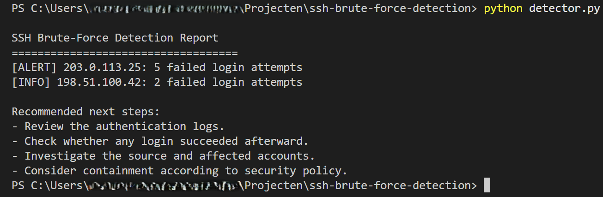
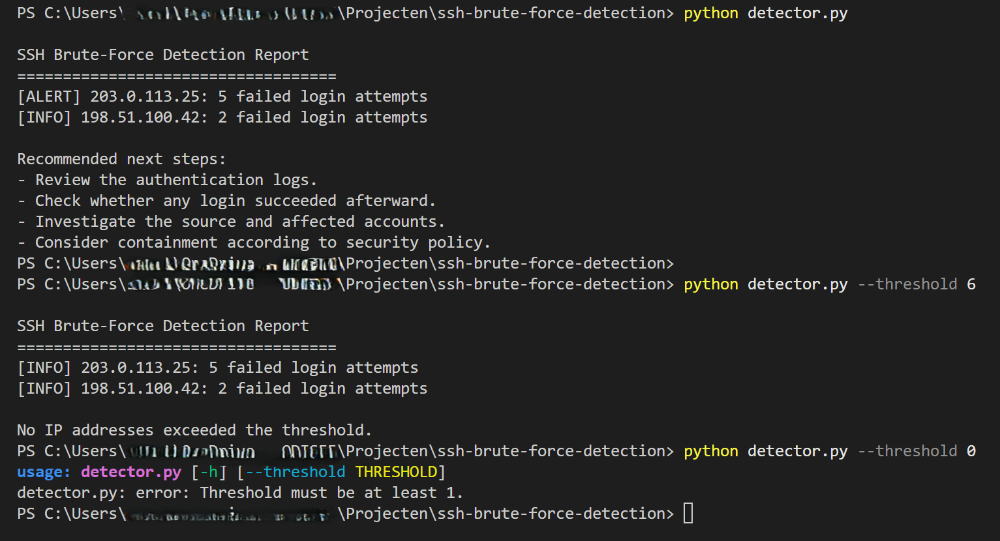
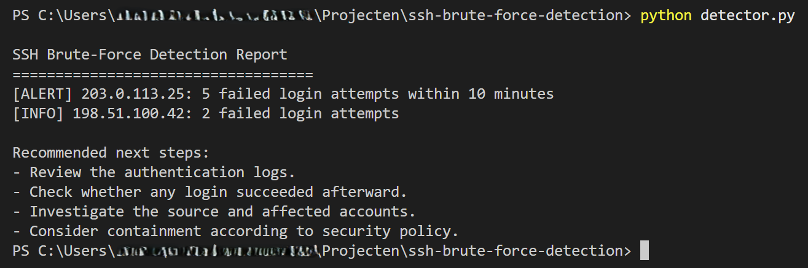
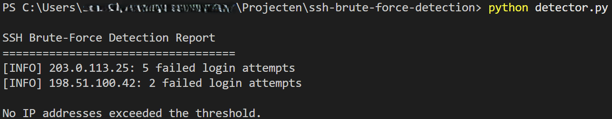
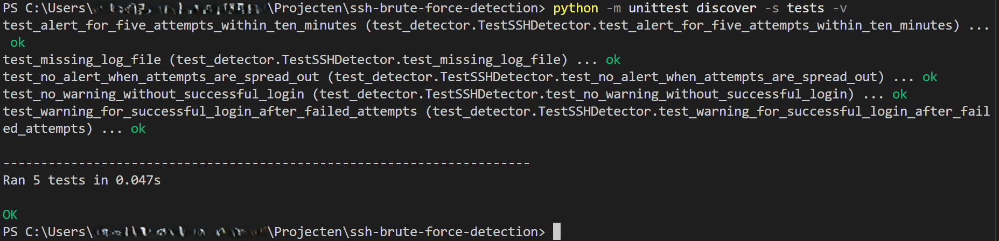

# SSH Brute-Force Detection PoC

A Python-based proof of concept (PoC) that analyses simulated Linux SSH authentication logs to identify potentially suspicious login activity.

This project was developed as a hands-on cybersecurity learning exercise focused on **Blue Team security monitoring, log analysis, basic threat detection, and incident investigation**.

## Project Overview

SSH brute-force attacks involve repeated attempts to gain access to a system by guessing login credentials. Analysing authentication logs can help identify repeated failed login attempts and highlight activity that requires further investigation.

This tool analyses SSH authentication log entries, groups failed login attempts by source IP address, and detects repeated failures within a rolling time window. It also checks whether a successful login from the same IP address occurred after the recorded failed attempts.

The project is an educational proof of concept, not a production-ready security monitoring solution.

## Features

- **SSH log analysis:** Reads Linux-style SSH authentication logs and identifies failed and successful password authentication events.
- **IP-based tracking:** Groups failed login attempts by source IP address.
- **Time-window detection:** Detects when an IP address reaches the configured threshold within a rolling 10-minute window.
- **Configurable threshold:** Allows the minimum number of failed attempts required for an alert to be changed through a command-line argument.
- **Successful login correlation:** Displays an additional warning when an IP address that triggered an alert has a subsequent successful login recorded.
- **Security reporting:** Displays alerts, informational messages, and recommended investigation steps.
- **Input validation:** Rejects threshold values below 1.
- **Missing-file handling:** Displays an error when the log file cannot be found, without an unhandled exception.
- **Automated tests:** Includes unit tests using Python's built-in `unittest` framework.

## Technologies

- Python 3
- `collections.Counter` — counting failed login attempts
- `datetime` and `timedelta` — timestamp parsing and time-window calculations
- `pathlib` — file handling
- `argparse` — command-line arguments
- `unittest` — automated testing

The project uses Python's standard library and requires no external Python packages.

## Project Structure

```text
ssh-brute-force-detector/
├── detector.py
├── sample_auth.log
├── README.md
├── screenshots/
│   ├── 01-python-version-and-detection.png
│   ├── 02-recommended-next-steps.png
│   ├── 03-threshold-validation.png
│   ├── 04-within-ten-minutes.png
│   ├── 05-outside-ten-minutes.png
│   └── 06-unittest-results.png
└── tests/
    └── test_detector.py
```

- `detector.py` — Contains the log analysis, detection logic, and reporting.
- `sample_auth.log` — Contains simulated SSH authentication events.
- `screenshots/` — Contains terminal screenshots documenting the output and test results.
- `tests/test_detector.py` — Contains automated unit tests.
- `README.md` — Project documentation and usage instructions.

## Getting Started

### Requirements

- Python 3 installed on your system.
- The project files listed above.

### Run the detector

Clone or download the repository and open a terminal in the project directory.

Run the detector with the default threshold of five failed login attempts within ten minutes:

```bash
python detector.py
```

### Configure the threshold

To require at least six failed attempts within ten minutes:

```bash
python detector.py --threshold 6
```

The threshold must be a positive integer. Values below `1`, such as `0`, are rejected.

The detector reads `sample_auth.log` from the project directory.

## Detection Logic

The detector processes the authentication log line by line.

1. **Identify authentication events.** The tool recognises lines containing `Failed password` and `Accepted password`.
2. **Extract timestamps and IP addresses.** The timestamp is parsed, and the source IP address is extracted from the log entry.
3. **Track failed attempts.** Failed login attempts and their timestamps are stored per IP address.
4. **Apply the rolling time window.** The tool determines the maximum number of failed attempts occurring within any ten-minute period.
5. **Generate alerts.** An alert is displayed when an IP address reaches the configured threshold within that period.
6. **Check for subsequent successful logins.** For an IP address that triggers an alert, the tool checks whether a recorded successful login occurred after its last recorded failed attempt.
7. **Provide investigation recommendations.** When suspicious activity is detected, the report suggests reviewing authentication logs, checking for subsequent successful logins, investigating the source, and considering containment in accordance with security policy.

A successful login is not counted as a failed attempt. The successful-login check is a basic correlation based on source IP address and timestamps; it does not prove that the successful login resulted from an attack.

## Testing

The detector was tested with simulated authentication logs and different threshold settings.

### Manual test scenarios

| Scenario | Expected result |
|---|---|
| Five failed attempts within ten minutes, using the default threshold | Alert |
| Five failed attempts spread across more than ten minutes, with no ten-minute window reaching the threshold | No alert |
| Two failed attempts from an IP address | Informational message |
| Threshold increased to `6` when an IP has only five attempts within the window | No alert for that IP |
| Threshold set to `0` | Input validation error |
| Successful login after suspicious failed attempts from the same IP | Alert and additional warning |
| No subsequent successful login | Alert without the additional warning |
| Log file missing | Error message without an unhandled exception |

The sample log entries and IP addresses are simulated. They do not represent a confirmed real-world attack.

### Automated unit tests

The project includes automated tests implemented with Python's built-in `unittest` framework.

Run the tests from the project root:

```bash
python -m unittest discover -s tests -v
```

The automated tests check:

- Alert generation when the threshold is reached within ten minutes.
- No alert when attempts are spread across a longer period.
- Warning generation when a successful login follows suspicious failed attempts.
- No warning when no subsequent successful login is recorded.
- Correct handling of a missing log file.

The tests use temporary log files, leaving the original sample log unchanged.

## Example Output and Screenshots

The following terminal screenshots document the implementation and testing process.

Save the screenshots in a folder named `screenshots` in the project root. The filenames below must match the actual image filenames for the images to display correctly on GitHub.

### 1. Python Version and Detection Output

Shows the Python version and an example report containing alerts and informational messages.



### 2. Recommended Investigation Steps

Shows the report generated when suspicious activity is detected, including the recommended next steps.



### 3. Configurable Threshold and Input Validation

Demonstrates the default threshold, a custom threshold of `6`, and rejection of a threshold of `0`.



### 4. Failed Attempts Within Ten Minutes

Shows the alert generated when repeated failed login attempts occur within the configured time window.



### 5. Failed Attempts Outside the Detection Window

Shows the informational output when the attempts are spread out so that no ten-minute window reaches the threshold.



### 6. Automated Unit Test Results

Shows the automated test run and its successful completion, indicated by `OK`.



## Limitations

- **Static input:** The detector analyses a sample log file and does not monitor a live system.
- **Simulated data:** The included events are test data, not evidence of actual malicious activity.
- **Timestamp assumptions:** Traditional syslog timestamps do not include a year. The implementation assumes the current year, which can cause incorrect interpretation of older logs or logs spanning a year boundary.
- **Basic correlation:** Successful logins are checked against the same IP address and the last recorded failed-login timestamp. The tool does not establish a causal relationship between failed and successful events.
- **IP-based detection:** Multiple users may share an IP address, and legitimate activity can trigger an alert.
- **No automatic response:** The tool does not block IP addresses, terminate sessions, or modify system security settings.
- **Limited log formats:** The parser is designed for the specific Linux-style log format used in the sample data.

An alert should be treated as an indicator for further investigation, not as definitive proof of compromise.

## Possible Future Improvements

- Support additional SSH authentication log formats and timestamps.
- Improve correlation between failed and successful login events, including affected usernames.
- Export detection results to JSON or CSV.
- Add live log monitoring.
- Integrate with a SIEM or centralised logging platform.
- Expand the automated test suite with additional edge cases.

## Responsible Use

This project is intended for educational purposes and defensive security analysis. It demonstrates basic techniques for identifying potentially suspicious SSH authentication activity.

It does not perform login attempts, attack real systems, or automatically take action against a host.

## Acknowledgements and AI Disclosure

This project was developed as a personal learning exercise in cybersecurity.

ChatGPT (OpenAI) was used to help explain Python concepts, discuss implementation choices, troubleshoot errors, and develop and test the detection logic. The code was run and tested iteratively during development.

The project applies established cybersecurity concepts, including authentication log analysis and brute-force detection. It is an educational proof of concept rather than an original security research project or a production-ready tool.